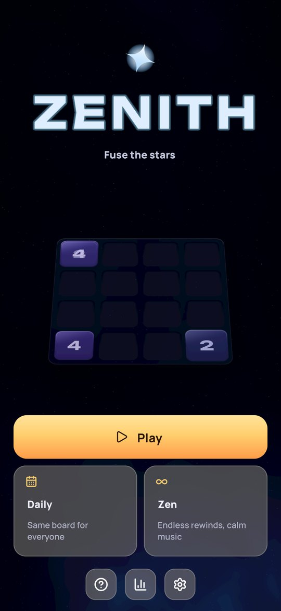
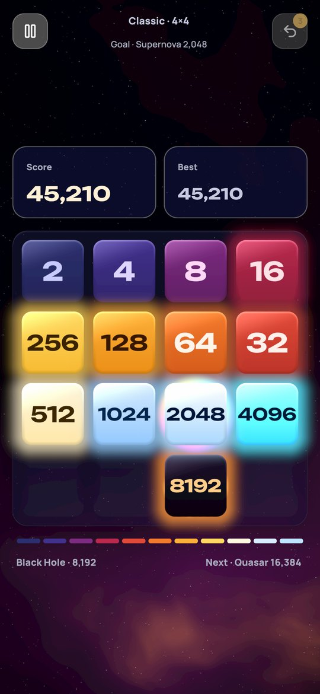
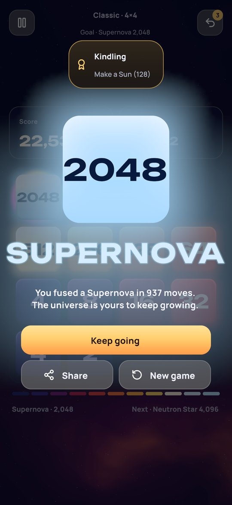
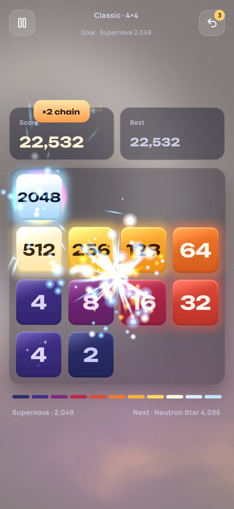
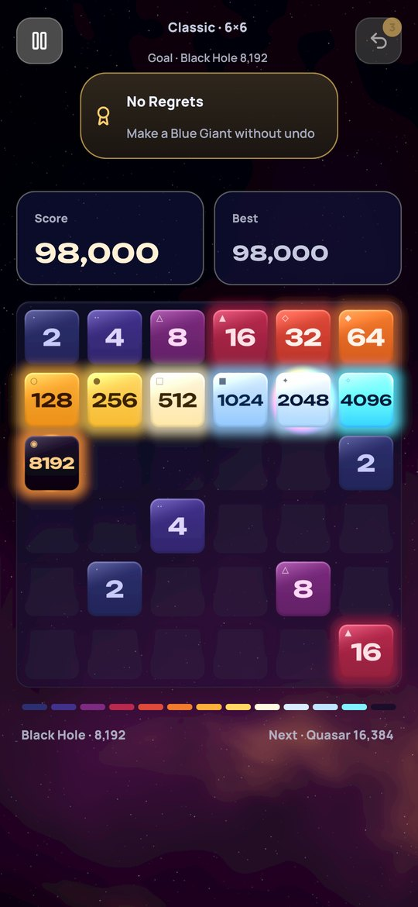
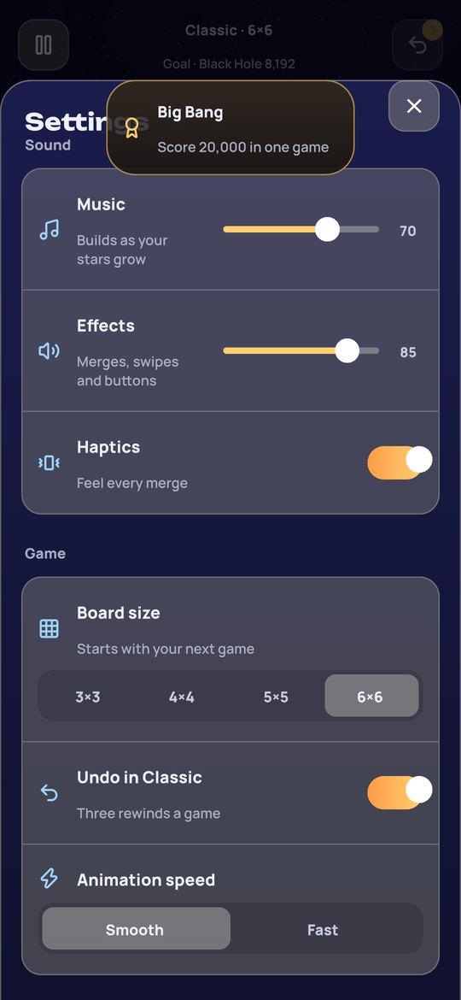
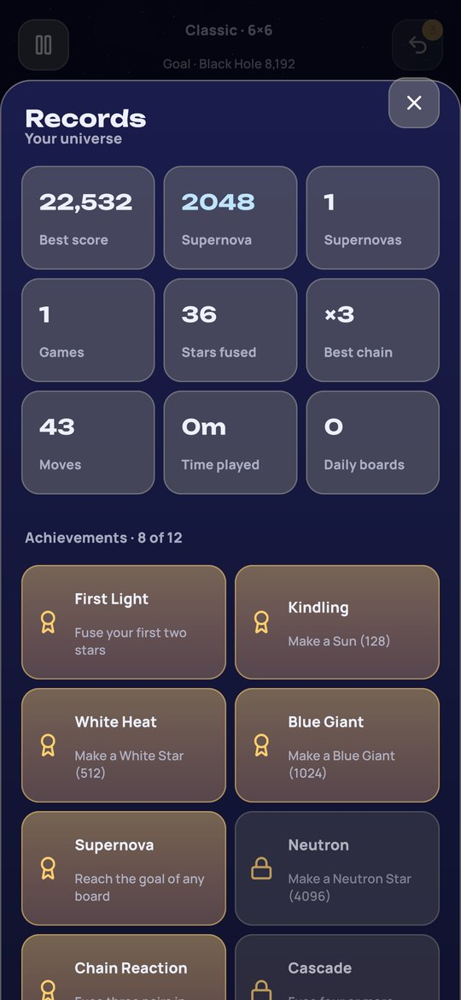
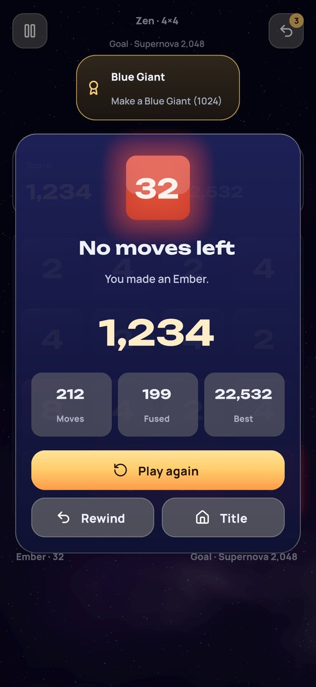

# Zenith, built in Unity: a 2048 merge puzzle with a living soundtrack

Zenith is 2048 where every tile is a star. Push two of the same together and they fuse into a hotter one: stardust becomes a red dwarf, a sun, a white star, a blue giant, and at 2048 a **Supernova**. The soundtrack grows with your game, from a single pad to a full heroic theme with war drums and a choir as your biggest star climbs, and every merge rings a bell in tune with the music.

This is the Unity edition of [Zenith](https://github.com/neomaverick1/zenith): the same game, rules and music, rebuilt in **Unity 6** with custom shaders, bloom, a particle system and native haptics.

**Play it in a browser:** [neomaverick1.github.io/zenith-unity](https://neomaverick1.github.io/zenith-unity/), with sound on.

**Phone apps:** [download Zenith.apk](https://github.com/neomaverick1/zenith-unity/releases/latest/download/Zenith.apk) for Android. The [latest release](https://github.com/neomaverick1/zenith-unity/releases/latest) also has the Google Play bundle and the Xcode project for iPhone.

<p>
  
  
  
  
</p>
<p>
  
  
  
  
</p>

## What makes it different

| | |
| --- | --- |
| **A soundtrack that grows with you** | Six intensities of the same eight-bar piece play in lockstep, and the game crossfades between them on the downbeat as your biggest star reaches 16, 64, 256, 1024 and 2048, with a cinematic hit to mark each step up. Zen mode keeps it calm. |
| **Merges you can hear** | Each merge rings a bell tuned to the chord playing at that moment, one step higher for every doubling, panned to where it happened on the board. Several merges in one move strum like a harp. 512 and up add a deep hit and the music ducks to make room; 1024 brings the trailer horn. |
| **Light that blooms** | Tiles are drawn by a custom shader: a gradient face, a glassy sheen, a rim of light, a glow in the star's color, a sweep of light across hot stars, a rainbow corona around the Supernova, a breathing Neutron Star and a Black Hole's accretion disk. HDR bloom makes the brightest stars and sparks glow for real. |
| **A sky that reacts** | The background is a nebula shader that warms from deep blue to violet and gold as the game goes on. Every merge sends a shockwave through it in the star's color, and the Supernova floods it with light. |
| **Impact** | Sparks burst from each merge (a GPU particle system, a third of them streaking), big merges shake the board, and the biggest ones punch the lens with chromatic aberration and distortion. |
| **Feel** | Haptics are tuned per moment: Android's own click effects and waveforms, and iPhone's impact and notification feedback. |
| **Modes** | Classic (three rewinds a game), Daily (the same board for everyone that day, identical to the web version's) and Zen (endless rewinds, calm music). Boards from 3×3 to 6×6. |
| **Records** | Best scores by mode and size, biggest star, Supernovas, chains, moves, time played, daily boards, and twelve achievements. The game in progress is saved. |
| **Settings** | Music and effects volume, haptics, board size, undo, animation speed, graphics quality (Ultra, Balanced, Battery saver), reduce motion, star names on tiles, and color-blind marks so color is never needed to tell stars apart. |

## How it's built

- [`Scripts/Game/Engine.cs`](Assets/Zenith/Scripts/Game/Engine.cs): the rules, with no screen attached. Every move returns a new game, so undo is going back one, and the board animates from the old game to the new one. The random numbers match the web version bit for bit, so a daily board is the same on every device ([`Editor/Checks.cs`](Assets/Zenith/Editor/Checks.cs) verifies it).
- [`Scripts/FX/BoardView.cs`](Assets/Zenith/Scripts/FX/BoardView.cs): the board in the 3D scene. Each star keeps its view as it slides, so two stars that merge visibly slide into each other before the new star pops in.
- [`Shaders/`](Assets/Zenith/Shaders): the tile, board, nebula and spark shaders (URP, HLSL). The nebula renders into a small texture at a rate set by the graphics quality, which keeps phones cool.
- [`Scripts/Audio/Sound.cs`](Assets/Zenith/Scripts/Audio/Sound.cs): the music engine. Seven loops start together on the audio clock and stay sample-locked; changes land on the next downbeat. Bells, hits and effects are scheduled on the same clock, tuned to the chord of the current bar.
- [`Scripts/UI/`](Assets/Zenith/Scripts/UI): the interface, built with UI Toolkit and one style sheet, sized in layout points so it's the same physical size on every screen and stays clear of notches.
- [`Scripts/Platform/Native.cs`](Assets/Zenith/Scripts/Platform/Native.cs) with [`Plugins/`](Assets/Zenith/Plugins): haptics and sharing on Android, iPhone and the web.
- The music and sounds were synthesized from scratch with the web version's synthesizer and rendered to audio, so both editions sound the same.

## Built with

- **Unity 6** (6000.6), **Universal Render Pipeline** with the 2D renderer, **HLSL** shaders, **Shuriken** particles, **URP post-processing** (bloom, chromatic aberration, lens distortion)
- **UI Toolkit** for the interface, **TextMeshPro** for the numbers on the stars, the **Input System** for swipes and keys
- **IL2CPP** builds for Android (64-bit, Google Play ready), iPhone and WebGL

## Build it

Open the project in Unity 6000.6.9f1, or from the command line:

```bash
Unity -batchmode -quit -projectPath . -executeMethod Zenith.EditorTools.Setup.Run      # fonts, materials, scene, app settings
Unity -batchmode -quit -projectPath . -executeMethod Zenith.EditorTools.Builder.Android # Builds/Android/Zenith.apk
Unity -batchmode -quit -projectPath . -executeMethod Zenith.EditorTools.Builder.AndroidBundle
Unity -batchmode -quit -projectPath . -executeMethod Zenith.EditorTools.Builder.IOS     # Builds/iOS, an Xcode project
Unity -batchmode -quit -projectPath . -executeMethod Zenith.EditorTools.Builder.Web     # Builds/Web
```

Keys on a computer: arrows or WASD to move, Z to undo, Esc to pause.

Fonts: Unbounded and Manrope (SIL Open Font License), symbols from DejaVu Sans.
